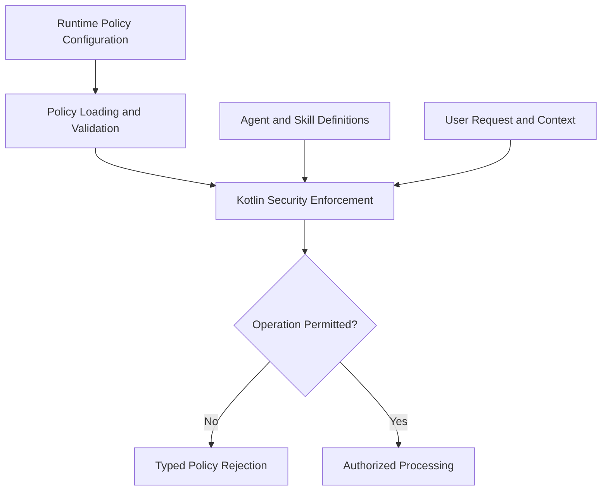

# Runtime Policies

**Status:** PLANNED — Policy enforcement integration in Milestone B

This directory is reserved for declarative runtime policies used by Integrated AI Workbench.

Policies define operational restrictions for model execution, project grounding, agent capabilities, tool permissions,
and sensitive information handling.

Policy configuration does not independently enforce security. All security-sensitive decisions must be validated and
enforced by the corresponding Kotlin components.

## Policy Areas

### Execution Policy

- Local-first inference with Workbench-managed runtimes.
- No mandatory cloud services or independently operated AI applications.
- No implicit fallback to remote inference.
- Explicit validation of model profiles and runtime capabilities.
- Bounded execution, timeouts, cancellation, and resource cleanup.
- Remote inference only when explicitly supported and authorized by a future implementation.

### Grounding Policy

- Access limited to explicitly approved project roots and files.
- Canonical path validation and protection against traversal.
- Binary-file exclusion and supported content-type restrictions.
- Configurable file count, file size, and context limits.
- Sensitive-content filtering.
- Safe provenance for included and excluded sources.
- No automatic unrestricted project scanning.

### Agent and Skill Policy

- Agents may use only explicitly permitted runtime skills.
- Markdown instructions cannot modify application security policies.
- Agent capabilities must be validated against model and runtime support.
- Untrusted project content cannot grant additional permissions.
- Runtime configuration remains separate from Codex development automation.

### Tool Permission Policy

- Deny unauthorized tool operations by default.
- Validate requested operations and parameters.
- Require explicit authorization for sensitive or high-impact actions.
- No unrestricted filesystem modification, command execution, or network access.
- Model-generated instructions are not execution permissions.

Actual tool execution requires a separately authorized implementation.

### Data Protection Policy

- Do not expose credentials, tokens, or private keys.
- Exclude sensitive values from logs and execution reports.
- Apply input and output validation.
- Keep user-owned model files outside source control.
- Store persistent credentials through an approved secure mechanism when required.
- Minimize retained prompt content and execution metadata.

## Enforcement Architecture

Markdown policy files and agent instructions are configuration inputs, not executable authority.

The effective policy must be determined by the application and must not be weakened by model-generated content.

## Implementation Responsibilities

Policy integration is distributed across the existing development tasks:

| Task     | Responsibility                                            |
|----------|-----------------------------------------------------------|
| TASK-004 | Runtime lifecycle and execution restrictions              |
| TASK-006 | Validated runtime instruction loading                     |
| TASK-007 | Grounding, prompt, input, output, and permission controls |
| TASK-008 | Policy enforcement during agent execution                 |
| TASK-010 | Evaluation and judge restrictions                         |
| TASK-011 | Integrated policy verification                            |

The Base Plugin currently contains security contracts and bootstrap components. This directory does not yet contain
operational policy definitions.

Policy formats and loading behavior must be established by the applicable implementation tasks rather than assumed in
advance.

## Related Documentation

- [Security Architecture](../../docs/security/README.md)
- [Base Plugin Architecture](../../docs/architecture/README.md)
- [AI Requirements](../../docs/development/AI-REQUIREMENTS.md)
- [Implementation Tasks](../../docs/development/tasks/README.md)

The runtime policy system must remain consistent with these documents and the repository's root README.