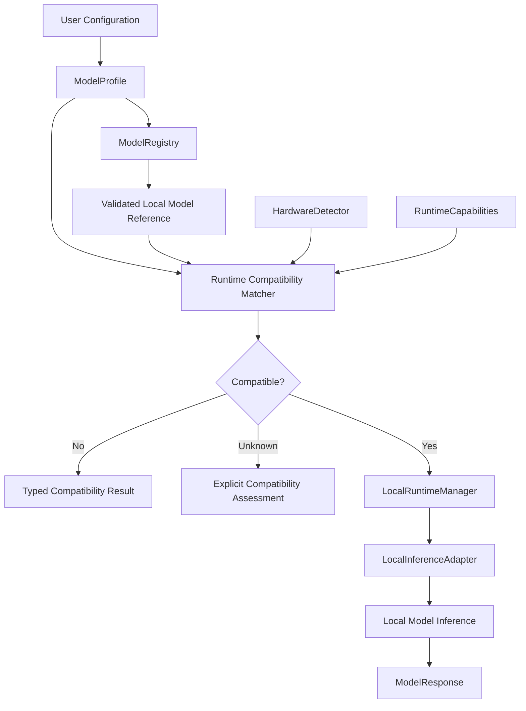

# Model Profiles

**Status:** PARTIAL — Runtime profile management planned for Milestone B

This directory documents the model profile configuration principles used by Integrated AI Workbench.

A model profile defines how a registered language model should be executed, which capabilities are required, and which
generation settings should be applied.

Profiles are separate from model binaries, runtime implementations, and agent instructions.

## Profile Configuration

A model profile should represent the applicable configuration:

- Stable profile identifier and display name.
- Reference to a registered, user-owned model.
- Local execution policy.
- Preferred execution device or runtime requirements.
- Generation and sampling parameters.
- Maximum generated tokens.
- Execution timeout.
- Thinking-level preference, where supported.
- Structured-output requirements.
- Applicable context and resource limits.

Use typed, validated configuration contracts.

Do not duplicate model binary metadata already maintained by the model registry.

## Model Profile Architecture

The intended relationship between model configuration, hardware capabilities, and local inference is:

The diagram describes the planned architecture, not functionality already available in the bootstrap.

A valid model profile does not guarantee that the selected runtime can execute the referenced model.

Compatibility must be established separately before model loading.

## Generation Parameters

Supported profile settings may include:

| Parameter          | Purpose                                                  |
|--------------------|----------------------------------------------------------|
| `temperature`      | Controls applicable sampling randomness                  |
| `topP`             | Controls nucleus sampling                                |
| `topK`             | Limits candidate tokens where supported                  |
| `maxOutputTokens`  | Limits generated output length                           |
| `timeout`          | Bounds execution duration                                |
| `thinkingLevel`    | Expresses the requested reasoning effort where supported |
| `structuredOutput` | Defines applicable structured-response expectations      |

Exact field names and supported parameter ranges are determined by the shared Kotlin contracts and selected runtime
capabilities.

Unsupported explicitly requested settings must not be silently ignored.

Profiles must distinguish requested configuration from effective runtime settings.

Thinking-level configuration does not imply access to hidden model chain-of-thought.

## Local Model References

Model files remain user-owned and are not stored in this directory.

Model references must be resolved through the validated model registry.

Required principles:

- Explicit user selection.
- Validated local filesystem references.
- No automatic drive-wide model scanning.
- No automatic model downloads.
- No model binary contents in configuration.
- No implicit cloud fallback.
- Revalidation of model paths before execution.

Model registration and profile configuration are separate responsibilities.

## Configuration Storage

User-specific model profiles should be persisted through an appropriate IntelliJ Platform configuration mechanism.

Persistent configuration must:

- Remain separate from version-controlled project resources by default.
- Preserve profile identifiers and model associations.
- Validate restored configuration.
- Handle missing or relocated models safely.
- Keep credentials outside ordinary profile configuration.
- Use IntelliJ PasswordSafe for persistent secrets when applicable.

This directory may later contain reusable, non-sensitive profile templates if explicitly required.

It must not contain user-specific credentials, private model locations, or model binaries.

## Runtime and Agent Integration

A model profile determines execution configuration, not agent behavior.

Runtime agents under `.ai/agents/` may reference compatible model profiles or declare required capabilities.

Runtime skills under `.ai/skills/` define workflows and instructions.

The Workbench must validate agent requirements, profile configuration, model availability, and runtime capabilities
before execution.

A single registered model may be associated with multiple profiles configured for different supported execution
behaviors.

A profile must not independently grant tool permissions or expand project filesystem access.

## Implementation Responsibilities

| Task     | Responsibility                                                         |
|----------|------------------------------------------------------------------------|
| TASK-001 | Shared profile contracts, validation, and thinking-level configuration |
| TASK-002 | Model registry, validated paths, and profile associations              |
| TASK-003 | Hardware capabilities and compatibility matching                       |
| TASK-004 | Managed runtime selection and lifecycle                                |
| TASK-005 | Applying supported profile settings during actual inference            |
| TASK-008 | Agent-to-profile compatibility and execution integration               |
| TASK-009 | Profile selection through the IntelliJ Tool Window                     |
| TASK-011 | Integrated profile and inference verification                          |

Profile configuration must be implemented incrementally using the existing architecture.

## Related Documentation

- [Base Plugin Architecture](../../docs/architecture/README.md)
- [Managed Local Runtime Decision](../../docs/architecture/ADR-001-managed-local-runtime.md)
- [Security Architecture](../../docs/security/README.md)
- [AI Requirements](../../docs/development/AI-REQUIREMENTS.md)
- [Implementation Tasks](../../docs/development/tasks/README.md)

The Kotlin implementation and verified runtime capabilities remain authoritative for supported profile properties.

Do not introduce additional configuration formats or profile files without a concrete implementation requirement.