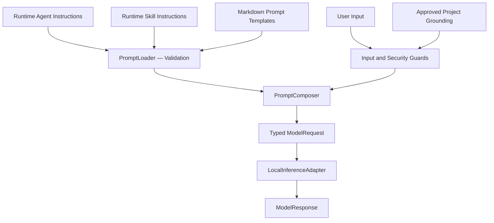

# Runtime Prompts

**Status:** PLANNED — Runtime prompt loading and composition in Milestone B

This directory is reserved for reusable Markdown prompt templates used by Integrated AI Workbench.

Prompt templates provide structured, reusable instructions for model interactions. They complement runtime agents and
skills without replacing their responsibilities.

The Base Plugin must support prompt configuration independently of specific inference providers or models.

No provider-specific prompt templates are bundled during bootstrap.

## Prompt Architecture

The Workbench separates prompt definition, loading, composition, and execution.

- `PromptLoader` — loads and validates approved Markdown prompt resources.
- `PromptComposer` — combines instructions, examples, user input, and approved context into structured prompt parts.
- `InputGuard` — validates applicable request inputs and limits.
- `SecretSanitizer` — filters sensitive information before model execution.
- `LocalInferenceAdapter` — translates validated prompt parts into the selected runtime's supported request format.

Prompt templates must remain declarative. They cannot execute commands, access arbitrary files, or grant permissions.

### Prompt Processing

The diagram describes the intended Milestone B architecture, not functionality already available during bootstrap.

Security policies must be enforced programmatically throughout the execution workflow.

## Prompt Roles

The Workbench must preserve distinct prompt components:

| Component           | Purpose                                               |
|---------------------|-------------------------------------------------------|
| System instructions | Establish application-level behavior and constraints  |
| Agent instructions  | Define the selected agent's role and responsibilities |
| Skill instructions  | Provide task-specific workflow guidance               |
| User input          | Represent the current user request                    |
| Grounding context   | Supply explicitly approved project information        |
| Examples            | Support one-shot and few-shot prompting               |
| Output requirements | Specify expected response structure and formatting    |

Prompt roles must remain distinguishable in shared execution contracts.

The selected inference adapter is responsible for mapping them to supported runtime message formats.

Provider-specific role handling must not weaken application security or permission boundaries.

## Prompting Methods

The architecture must support relevant prompting methods:

- **Zero-shot** — instructions without task-specific examples.
- **One-shot** — instructions with one relevant example.
- **Few-shot** — instructions with multiple bounded examples.
- **Grounded prompting** — instructions supplemented with approved contextual information.
- **Structured-output prompting** — instructions defining expected machine-readable results.

These methods may be combined when appropriate.

Prompt examples must be explicitly configured, validated, and subject to context-size limits.

The Workbench must support comparable zero-shot and example-guided execution using consistent model settings.

## Template Loading and Validation

Runtime prompt templates must be loaded from approved locations.

Required principles:

- Load Markdown resources without recompiling the plugin.
- Validate required metadata and template structure.
- Reject malformed or unsupported definitions.
- Resolve references only within approved runtime configuration boundaries.
- Prevent directory traversal and unauthorized file access.
- Restrict template variables to explicitly supplied, validated values.
- Apply input and context limits before inference.
- Handle missing templates and invalid substitutions predictably.
- Preserve applicable template identification and version information for execution provenance.

Do not introduce arbitrary template expressions, script execution, or unrestricted filesystem includes.

The exact template format must be established through the existing Kotlin contracts and implementation tasks.

## Security and Trust

Prompt templates are configuration resources, not security enforcement mechanisms.

Required safeguards include:

- Separation of trusted application instructions from untrusted input.
- Controlled insertion of user input and grounding context.
- Secret filtering before inference.
- Explicit prompt and context limits.
- No unauthorized escalation of agent or tool permissions.
- No automatic execution of model-generated instructions.
- No unnecessary storage or logging of complete prompts.

Prompt injection cannot be reliably prevented through instruction wording alone.

Filesystem permissions, runtime policies, and tool authorization must remain enforceable independently of model
behavior.

## Integration with Agents and Skills

Runtime agents are defined under `.ai/agents/`.

Reusable runtime workflows are defined under `.ai/skills/`.

Prompt templates under `.ai/prompts/` provide optional reusable instructions and formatting structures.

An agent or skill may reference an approved prompt template when supported by the runtime configuration loader.

Templates must not duplicate the complete agent or skill definition unnecessarily.

The Workbench must validate the relationships between selected agents, skills, templates, and model requirements before
execution.

## Implementation Responsibilities

| Task     | Responsibility                                                           |
|----------|--------------------------------------------------------------------------|
| TASK-006 | Load and validate applicable Markdown prompt resources                   |
| TASK-007 | Implement prompt composition, examples, grounding, and security controls |
| TASK-008 | Integrate validated prompts with actual agent execution                  |
| TASK-009 | Provide user-facing prompt interaction through the IntelliJ Tool Window  |
| TASK-011 | Verify prompt configuration and composition in the integrated workflow   |

Prompt templates must remain independent of inference-provider implementations.

## Current State

The directory currently contains documentation only.

Reusable prompt templates and their runtime-loading behavior have not yet been implemented or verified.

New template files should be introduced only when required by an implementation task.

Do not create placeholder templates merely to populate this directory.

## Related Documentation

- [Base Plugin Architecture](../../docs/architecture/README.md)
- [Security Architecture](../../docs/security/README.md)
- [AI Requirements](../../docs/development/AI-REQUIREMENTS.md)
- [Implementation Tasks](../../docs/development/tasks/README.md)
- [Runtime Policies](../policies/README.md)
- [Model Profiles](../profiles/README.md)

The implementation must remain consistent with the repository's root README and established runtime contracts.