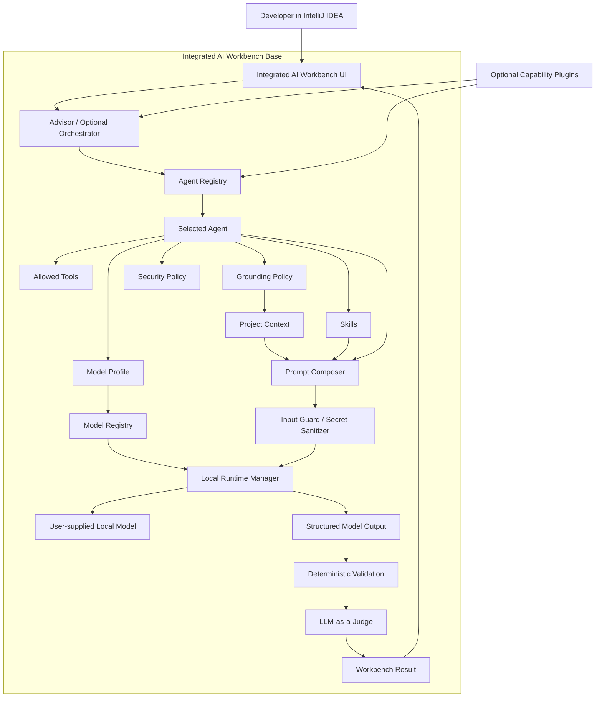
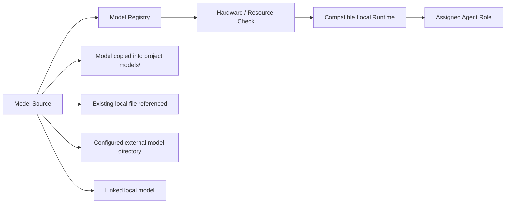
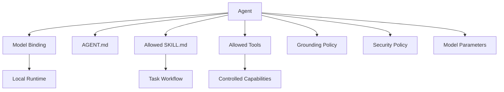
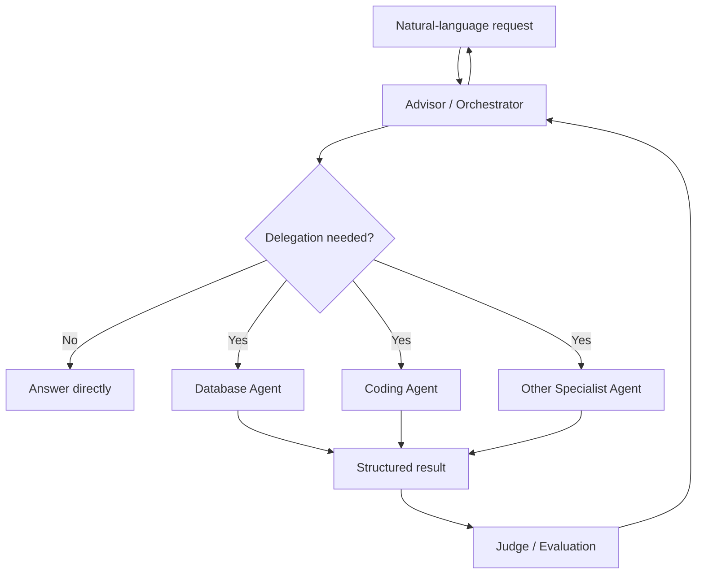
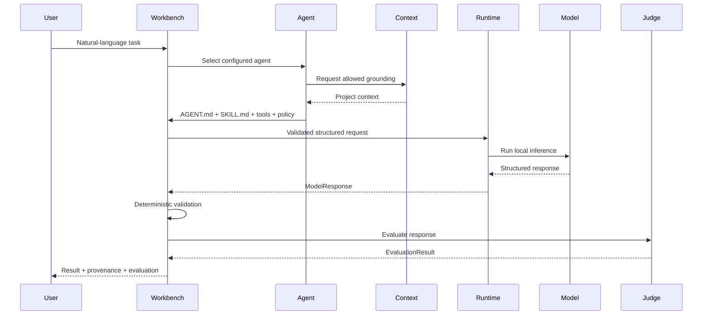
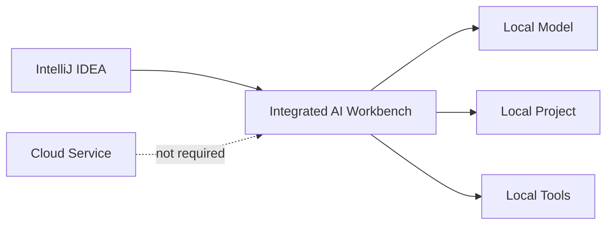
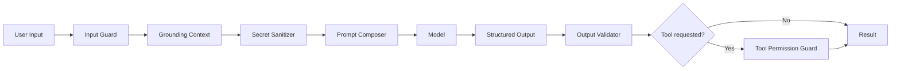
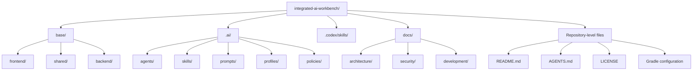
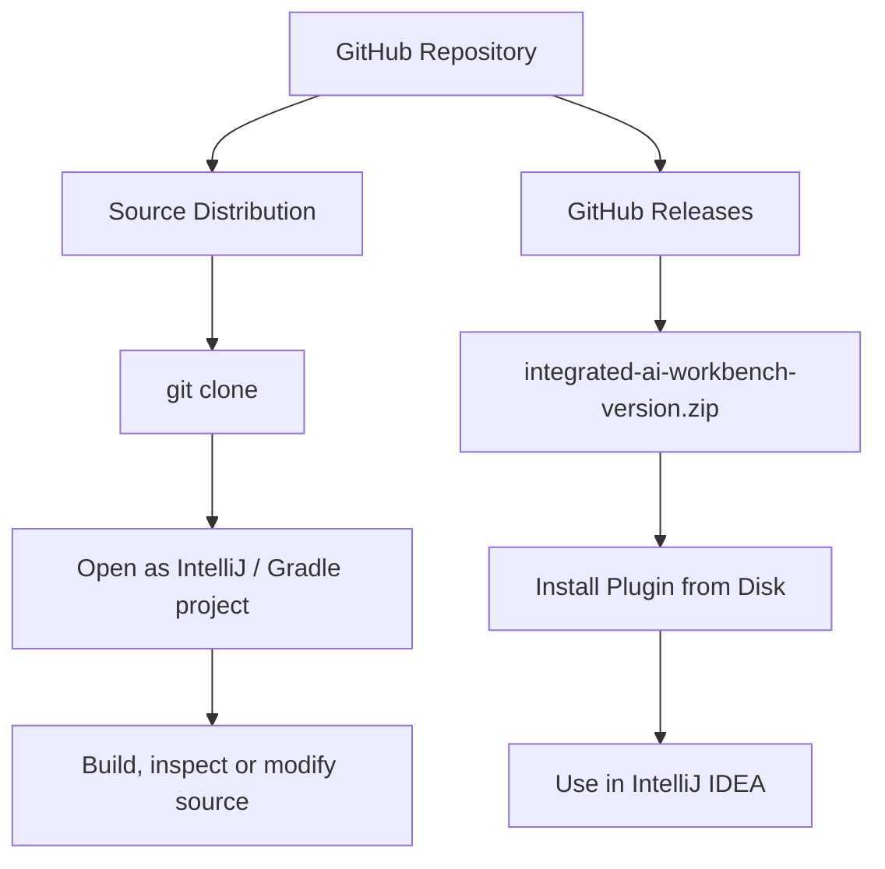
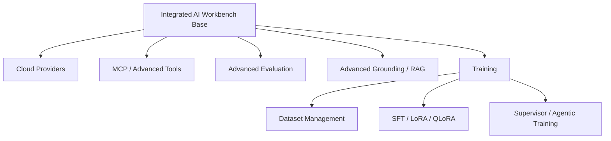

# Integrated AI Workbench

**Integrated AI Workbench** is a local-first AI development environment integrated directly into IntelliJ IDEA.

The project is designed to make local language models, project grounding, agents, reusable skills, controlled tools, structured output, security policies, and evaluation part of the IDE workflow itself.

The Base Plugin does **not bundle or require a specific AI model**. Models are supplied and selected by the user. The same model may serve several agent roles, or different models may be assigned to specialized agents.

External AI services are optional extensions, not a requirement for the core Workbench.

**Current version:** `0.1.0-SNAPSHOT`  
**Current status:** Base Plugin MVP in development

---

## What Is This Repository For?

This repository contains the source code and documentation for the **Integrated AI Workbench Base Plugin**.

The Base Plugin is intended to provide the minimum complete platform required to:

- register and run user-supplied local AI models;
- detect available system resources;
- assign models to configurable agents;
- associate agents with `AGENT.md`, `SKILL.md`, tools and policies;
- provide controlled project grounding;
- compose system, task, context and user prompts;
- configure model parameters and reasoning level;
- validate input and output;
- produce structured model responses;
- evaluate results using deterministic checks and LLM-as-a-Judge;
- optionally coordinate several specialized agents through an advisor/orchestrator;
- operate locally and offline when project confidentiality requires it.

The Base Plugin must remain useful without cloud services, another AI application, or another AI plugin.

---

## Architecture



The architectural rule is:

> **Local inference is a native Workbench capability. Remote inference is optional.**

The plugin provides the integration, orchestration and runtime-management layer. The actual model remains the user's choice.

---

## Models

No model is distributed with the plugin.

A project may use a conventional `models/` directory, or the user may configure other local model locations.



A model file may therefore be:

- physically stored under the project;
- referenced from another local directory;
- linked to the project;
- discovered from a configured model location.

Large model files should normally remain outside Git version control.

The Workbench records their configuration and role assignment rather than treating model binaries as project source files.

---

## Agents, Skills and Tools

An agent is not equivalent to a model.

An agent is a configured worker that combines a model with a particular role, instructions, capabilities and restrictions.



Conceptually:

```text
Agent
=
Model binding
+ AGENT.md
+ Skills
+ Tools
+ Grounding policy
+ Security policy
+ Model parameters
```

The same model may be assigned to several agents.

For example, one local model may simultaneously serve as:

- Coding Agent;
- Database Agent;
- General Advisor;
- Judge Agent.

The behavioral difference comes from the agent configuration rather than requiring a separate model for every role.

---

## Advisor and Orchestration

A dedicated orchestrator is useful when several specialized agents or models are available.

If only one model and one effective agent exist, unnecessary orchestration should be avoided.

With multiple agents, the conversational advisor may also act as the orchestrator.



For example:

```text
"Inspect the database schema, implement the repository,
and verify that it follows the project architecture."
```

may become:

```text
Database Agent
→ schema analysis

Coding Agent
→ implementation

Judge Agent
→ architecture evaluation
```

The user should be able to see which agents, models, skills and tools participated in the run.

---

## Project Grounding

The Workbench should never send an entire project to a model merely because it is available.

Grounding is controlled and explicit.

Possible sources include:

- active file;
- selected code;
- explicitly selected files;
- applicable `README.md` files;
- API specifications;
- database schema;
- Git diff;
- compiler output;
- test output.

Grounding limits may include:

- allowed project roots;
- maximum number of files;
- maximum file size;
- maximum context size;
- binary-file exclusion;
- secret filtering.

The UI should make the effective context visible before or after execution.

---

## AI Instruction Files

The Workbench uses human-readable Markdown files as part of its runtime logic.

### `AGENT.md`

Defines the role, responsibilities, restrictions and behavior of an agent.

### `SKILL.md`

Defines a repeatable workflow that an agent can execute.

A skill may also contain one-shot or few-shot examples.

### Prompt files

Reusable prompt templates and evaluation prompts may also be stored as Markdown.

Project-specific AI configuration may use:

```text
.ai/
├── agents/
├── skills/
├── prompts/
├── profiles/
└── policies/
```

The Base Plugin may also provide built-in agent and skill definitions required for its own standard workflows.

---

## MVP Execution Flow



The MVP is complete when at least one real workflow can execute this path end to end.

---

## AI Concepts Implemented in the MVP

| Concept | Integrated AI Workbench implementation |
|---|---|
| Grounding | Controlled project context |
| System + user roles | Prompt composition with separate roles |
| Reasoning / Chain-of-Thought concept | Provider/runtime thinking configuration and concise reasoning summary |
| Basic security | Input/output validation, sanitation and length limits |
| One-shot / few-shot | Examples stored in `SKILL.md` |
| Structured output | Typed and validated model responses |
| Sampling parameters | Temperature, top-p, token limits and supported runtime parameters |
| Thinking level | Configurable through model profiles where supported |
| LLM-as-a-Judge | Dedicated evaluation workflow |
| Markdown prompts | `AGENT.md`, `SKILL.md` and prompt files loaded at runtime |

The application does not depend on exposing or storing a model's hidden private chain of thought. A concise structured reasoning summary may be requested where useful.

---

## Local and Offline Operation

The Base Plugin is designed so that a workflow can operate entirely on the developer's machine.



A local-only policy may prevent use of remote inference or remote tools.

This architecture can support environments with strong confidentiality requirements.

It should not, by itself, be interpreted as certification for processing classified information. Such environments may require separate organizational, hardware, operating-system, network, supply-chain and regulatory controls.

---

## Runtime and Hardware Management

The Base Plugin is responsible for integrating with supported local inference runtimes.

Models and runtimes are separate concepts:

```text
Model
→ the AI model selected by the user

Runtime
→ software capable of executing that model

Workbench
→ manages the relationship between the project, agent, model and runtime
```

The runtime layer should be pluggable rather than tied permanently to one implementation.

The Workbench should also detect relevant resources where possible, including:

- operating system;
- CPU architecture;
- available CPU resources;
- system memory;
- available GPU devices;
- supported GPU backend;
- GPU memory;
- runtime capabilities.

This information can be used to determine whether a selected model is compatible with the available system.

---

## Security

Security controls are part of the Base architecture rather than an optional later feature.



The MVP should provide at least:

- input length limits;
- context limits;
- secret filtering;
- output size limits;
- structured output validation;
- tool permissions;
- runtime timeouts;
- visible local/remote execution policy.

Credentials must not be committed to the project repository.

---

## Repository Structure

The exact implementation structure may evolve while the IntelliJ plugin is bootstrapped.

The intended responsibility boundaries are:



The `frontend`, `shared`, and `backend` boundaries are intended to keep the design compatible with IntelliJ Remote Development / Split Mode where appropriate.

They do not need to become separate physical modules merely for structural formality.

---

## Dependencies

The planned development baseline is:

- IntelliJ Platform;
- Kotlin;
- Gradle;
- IntelliJ Platform Gradle Plugin;
- JDK 21;
- supported local inference runtime integration.

No language model is a project dependency.

No cloud AI provider is required by the Base Plugin.

External provider integrations may later be delivered as optional capability plugins.

---

## How Do I Get Set Up?

### Requirements

For development:

- IntelliJ IDEA;
- JDK 21;
- Git;
- the Gradle Wrapper included with the repository.

Clone the project:

```powershell
git clone https://github.com/<owner>/integrated-ai-workbench.git
cd integrated-ai-workbench
```

Open the cloned directory in IntelliJ IDEA as a Gradle project.

---

## Configuration

A project using Integrated AI Workbench may configure:

- local model locations;
- model profiles;
- agent-to-model assignments;
- agent instructions;
- skills;
- tools;
- grounding policies;
- security policies;
- generation parameters.

Models remain user-controlled resources and are not committed to the Integrated AI Workbench source repository.

---

## Running the Development Plugin

The development version is launched in an IntelliJ Development Instance.

On Windows:

```powershell
.\gradlew.bat runIde
```

On macOS or Linux:

```bash
./gradlew runIde
```

This launches a sandbox IntelliJ instance with the development version of the plugin installed.

---

## Running Tests

On Windows:

```powershell
.\gradlew.bat test
```

On macOS or Linux:

```bash
./gradlew test
```

Deterministic application behavior should be tested deterministically.

Examples include:

- prompt composition;
- Markdown loading;
- model and agent configuration;
- input limits;
- secret sanitation;
- context selection;
- structured output parsing;
- output validation;
- routing rules;
- permission checks.

Model quality and nondeterministic behavior belong to explicit evaluation workflows rather than ordinary unit tests.

---

## Distribution

Integrated AI Workbench is distributed through GitHub in two forms.



### Installable Plugin

A GitHub Release provides a versioned IntelliJ plugin archive such as:

```text
integrated-ai-workbench-0.1.0.zip
```

Install it through:

```text
IntelliJ IDEA
→ Settings
→ Plugins
→ ⚙
→ Install Plugin from Disk
```

The plugin ZIP contains the plugin, not language-model binaries.

### Source Code

Developers may instead clone the entire repository and open it directly as an IntelliJ project.

GitHub may additionally generate its own source ZIP and TAR archives for each tagged release.

Those source archives are different from the installable IntelliJ plugin ZIP.

---

## Building the Installable Plugin

On Windows:

```powershell
.\gradlew.bat buildPlugin
```

The generated plugin distribution is expected under:

```text
build/distributions/
```

Release artifacts should use explicit version numbers, for example:

```text
integrated-ai-workbench-0.1.0.zip
```

JetBrains Marketplace publication is not required for the MVP.

---

## Contribution Guidelines

Before implementing a change, contributors and AI development tools should read:

1. `AGENTS.md`;
2. the root `README.md`;
3. the applicable subsystem documentation.

Changes should preserve:

- local-first operation;
- model independence;
- explicit security boundaries;
- IntelliJ Platform conventions;
- modular capability boundaries;
- reproducibility;
- clear separation between project configuration and machine-local state.

AI-generated code is subject to the same review standards as manually written code.

---

## Code Review

Changes should be reviewed for:

- architectural consistency;
- Base Plugin versus optional-extension scope;
- correct IntelliJ Platform API usage;
- UI thread safety;
- Split Mode implications;
- security and secret handling;
- context boundaries;
- model/runtime abstraction;
- agent permissions;
- structured output validation;
- testing;
- documentation consistency.

Large or irreversible operations must not be hidden behind AI automation.

---

## Future Capability Plugins

The Base Plugin is intended to remain relatively focused.

Additional capabilities may later be distributed as separate plugins, for example:



These extensions must not become requirements for the core local workflow.

---

## Project Ownership and Contact

The repository owner maintains the current architectural direction and Base Plugin scope.

Bug reports, feature requests, architectural proposals and contributions should use the repository's GitHub Issues and Pull Requests.

Issue reports should include relevant technical information such as:

- IntelliJ IDEA version;
- plugin version;
- operating system;
- runtime and model involved, where relevant;
- reproducible steps;
- expected behavior;
- actual behavior;
- sanitized logs.

Do not include API keys, passwords, access tokens, private model data, or confidential project content.

---

## License

Integrated AI Workbench is intended to be released under the **Apache License 2.0**.

See `LICENSE` for the complete license text.

Models, datasets, runtimes, libraries and external services used with the Workbench remain subject to their own licenses and terms.

---

## Guiding Principles

> **Models are interchangeable resources. Agents are configured workers. Skills define procedures. Tools define capabilities. The orchestrator coordinates workers when coordination is useful.**

> **Files define intent. Code defines capability. Persistent state records runtime state and history. PasswordSafe stores secrets.**

> **Local inference is a native Workbench capability. Remote inference is optional.**