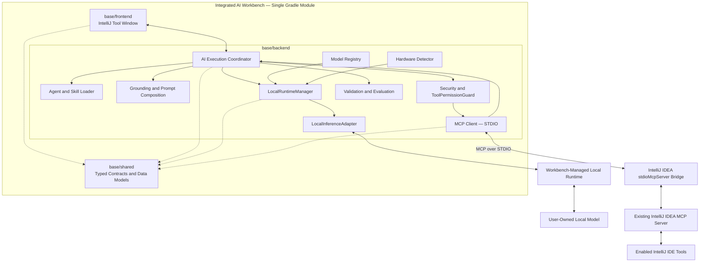
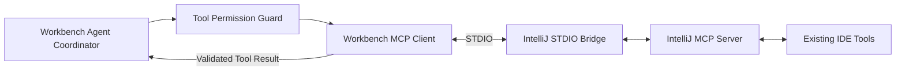
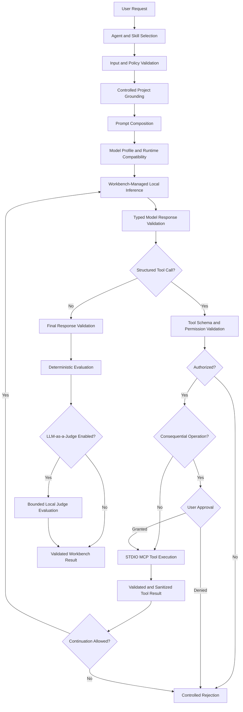

# Base Plugin Architecture

**Status:** PARTIAL — Milestone B implementation in progress

The Integrated AI Workbench Base Plugin uses a single Gradle module with source roots separated by responsibility:

- `base/frontend` — IntelliJ-native Tool Window, presentation, user interaction, and tool-approval interfaces.
- `base/shared` — typed contracts and data models shared across component boundaries.
- `base/backend` — model registry, hardware detection, local runtime management, agent execution, grounding, prompting,
  security, MCP tool integration, and evaluation.

These are logical responsibility boundaries, not separate deployable modules.

The architecture preserves the possibility of future IntelliJ Remote Development / Split Mode support without requiring
additional Gradle modules prematurely.

The Base Plugin uses Workbench-managed local inference and existing IntelliJ IDEA tools. Additional tools or
integrations may be implemented when existing capabilities are insufficient.

## Component Architecture

The following diagram represents the intended component relationships within the Base Plugin.

The diagram shows logical dependencies, responsibilities, and external communication boundaries. It does not imply that
all components run as separate processes.

`base/shared` provides common contracts. The backend coordinates execution and enforces application policies. The
frontend presents configuration, execution state, approval requests, and results.

The local inference backend may use a native library or a Workbench-managed process, depending on the validated runtime
implementation.

The MCP client is part of the Workbench backend. It uses IntelliJ IDEA's existing MCP Server rather than implementing a
second set of IDE tools.

The configured STDIO entry point may use an auxiliary process to communicate with the running IDE MCP Server. Its actual
lifecycle and connection behavior must be verified during implementation.

## Local Inference Architecture

Local inference is a native Base Plugin capability. Remote inference is optional.

The Workbench is designed to discover, configure, and manage compatible local inference runtimes for user-supplied
language models without requiring an independently operated AI application or cloud service.

The main architectural components are:

- `ModelRegistry` — model discovery, registration, locations, and metadata.
- `ModelProfile` — model configuration, generation parameters, and supported reasoning settings.
- `HardwareDetector` — system resources, GPU capabilities, and runtime compatibility information.
- `LocalRuntimeManager` — runtime selection, lifecycle management, model loading, unloading, and resource control.
- `LocalInferenceAdapter` — runtime-specific model execution behind a provider-neutral interface.

The Base Plugin does not bundle language-model binaries or require a specific inference engine.

Compatible native libraries or Workbench-managed runtime processes may provide the underlying inference capability.

The initial managed runtime implementation uses llama.cpp and a compatible user-supplied local GGUF model.

The inference integration uses the managed runtime's API. It does not require Codex CLI, LM Studio, Ollama, or mandatory
cloud services.

The runtime architecture must support controlled execution, timeouts, cancellation, failure recovery, and offline
operation when the required local resources are available.

Inference capabilities, including structured tool calling, must be validated against the selected runtime and model
rather than assumed to be universally available.

The technical approach and implementation constraints are documented
in [ADR-001 — Managed Local Runtime](ADR-001-managed-local-runtime.md).

## Agent and AI Workflow Architecture

The Workbench separates models, agents, skills, and tools:

- **Model** — a user-supplied inference resource.
- **Agent** — a configured worker combining a model profile, role, instructions, skills, and declared permissions.
- **Skill** — a reusable Markdown-defined workflow.
- **Tool** — an existing or custom-built capability accessed through an explicit permission boundary.
- **Advisor / Orchestrator** — optional coordination of specialized agents when required.

A single model may serve multiple agent roles without requiring separate model instances for every role.

Runtime instructions are maintained under `.ai/`, while Codex development skills are maintained separately under
`.codex/skills/`.

Runtime agent instructions do not grant unrestricted filesystem, process, network, or IDE access.

Tool permissions must be enforced by application logic and applicable IntelliJ IDEA security controls.

### IntelliJ MCP Tool Integration

The Base Plugin reuses existing IntelliJ IDEA tools exposed through the IDE's MCP Server.

The Workbench acts as an MCP client.

**Selected MVP transport: STDIO.**

The connection architecture is:

The STDIO connection uses IntelliJ IDEA's supported `stdioMcpServer` entry point.

The configured project path and MCP Server port identify the intended IntelliJ project and running server.

Executable paths, project paths, and ports are environment-specific configuration values and must not be hardcoded as
portable application defaults.

The Workbench must verify that the configured STDIO connection targets the intended IDE instance and project.

A Gradle Development Instance launched through `runIde` may have a different MCP Server, project, and port from the main
IntelliJ IDEA installation.

MCP transport selection does not change the underlying local inference architecture.

### Tool Discovery and Availability

Tools are managed through IntelliJ IDEA MCP settings, where available tools may be individually enabled or disabled.

Tool access requires:

1. A working connection to the intended MCP Server.
2. An exposed and enabled tool.
3. Permission from the selected runtime agent.
4. Authorization under Workbench security policy.
5. Validated tool arguments and resource boundaries.
6. User approval when required by the operation.

Only tools satisfying all applicable conditions may execute.

The Workbench must discover available tool names, descriptions, and argument schemas through the established MCP
connection.

Tool discovery does not itself grant execution authority.

The Workbench should reuse existing IDE tools rather than implementing equivalent file, editor, terminal, Git, or
project-navigation functionality.

Custom-built tools and additional integrations remain available as alternatives when justified by requirements.

### Tool Execution and Permissions

A local model may propose a tool call, but the Workbench controls whether that operation executes.

The model must produce a structured tool-call proposal that can be validated against the applicable tool definition.

Tool names, arguments, permissions, and relevant resource boundaries must be checked before execution.

Read-only operations may execute automatically when explicitly permitted by the selected agent, Workbench policy, and
IDE MCP Server.

Operations with potential side effects require explicit, operation-specific user approval.

Examples include:

- Project file modifications.
- Terminal or process execution.
- Git write operations.
- Configuration changes.
- Destructive IDE actions.

User approval must identify the requested operation and relevant affected resources.

Approval of one operation must not authorize unrelated future operations.

An IntelliJ setting that permits execution without confirmation does not override stricter Workbench authorization
requirements.

Unknown or unclassified tools must not receive automatic execution permission.

Tool execution must remain bounded by call counts, continuation limits, timeouts, and cancellation.

Tool results are untrusted data and must be validated, sanitized, and limited before returning them to the model.

The Workbench must not execute commands extracted from arbitrary free-form model text.

### AI Execution Pipeline

The intended execution flow is:

The tool execution branch is conditional. Requests that do not require tools must remain executable without an MCP call.

Tool proposals must be structured and validated before execution.

Authorized tool results return to the selected local model through the existing agent execution coordinator.

The model may then continue inference using the tool result.

Repeated tool execution is permitted only within the configured security and resource limits.

Rejected requests, invalid configurations, denied approvals, timeouts, disconnections, and runtime failures produce
controlled outcomes without bypassing mandatory validation.

Deterministic validation failures cannot be overridden by an LLM judge.

The LLM-as-a-Judge stage evaluates applicable model-output quality. It does not authorize tool execution or override
security decisions.

Security policies, tool permissions, and context restrictions must be enforced programmatically rather than relying
exclusively on Markdown instructions.

### Runtime Agent and Skill Boundaries

Runtime agent and skill configurations are loaded from `.ai/`.

The selected agent determines its applicable role, instructions, skills, and tool permissions.

Only authorized and available tool definitions may be supplied to the model.

Runtime skills provide instructions and reusable workflows but do not independently grant additional privileges.

The Judge Agent remains isolated from operational IDE tool execution unless a separate approved requirement changes that
boundary.

Development skills under `.codex/skills/` are used to implement and review the Workbench. They are not automatically
exposed as runtime tools or skills.

## IntelliJ Integration and Lifecycle

The Base Plugin uses IntelliJ Platform lifecycle and threading mechanisms.

Long-running inference, MCP communication, and tool operations must not block the Event Dispatch Thread.

The Tool Window communicates with established backend execution services and must not create a second independent
inference or agent coordination path.

The integration must support:

- Responsive model and agent selection.
- Prompt submission.
- Explicit project-context selection.
- Visible execution state.
- Tool availability and activity.
- Approval and rejection of consequential operations.
- Cancellation and failure handling.
- Validated result presentation.
- Safe disposal of background work and MCP sessions.

Workbench-managed runtime and STDIO processes must be cleaned up when their owning execution or project lifecycle ends.

Disconnected MCP sessions must not leave uncontrolled tool operations.

Cancellation, disposal, and asynchronous result handling must follow IntelliJ Platform requirements.

## Current Implementation

### Milestone A — Plugin Bootstrap

**Status: COMPLETE**

The following foundations have been established and validated:

- Gradle project configuration and dependency resolution.
- Kotlin source roots and architectural boundaries.
- IntelliJ Platform plugin descriptor and Tool Window registration.
- Core model, runtime, agent, prompting, grounding, security, and evaluation contracts.
- Minimal IntelliJ-native AI Workbench Tool Window.
- Successful compilation, plugin structure verification, and Development Instance startup.

### Milestone B — Base Plugin MVP

**Status: IN PROGRESS**

Implementation and verification are managed through TASK-001–TASK-011.

Based on the latest reported task evidence:

| Tasks             | Current reported progress                                                            |
|-------------------|--------------------------------------------------------------------------------------|
| TASK-001–TASK-003 | Shared contracts, model registry, and hardware compatibility verified                |
| TASK-004–TASK-005 | Managed local runtime and real local-model inference verified                        |
| TASK-006–TASK-008 | Runtime agents, skills, grounding, security, and structured agent execution verified |
| TASK-009          | Tool Window integration and actual STDIO MCP tool execution pending                  |
| TASK-010          | Deterministic evaluation and local judge integration in progress                     |
| TASK-011          | End-to-end MVP integration verification pending required dependencies                |

TASK-008 establishes the agent execution foundation and tool authorization boundaries. Its verified implementation does
not imply that real MCP tool execution is already operational.

TASK-009 must complete the connection between the existing agent coordinator, local model, IntelliJ Tool Window, and
IntelliJ MCP Server.

Mandatory TASK-009 verification includes a real read-only IDE tool call, delivery of the actual tool result to the local
model, and continuation to a validated response.

TASK-010 completes the evaluation and local judge integration.

TASK-011 verifies the full MVP, including real local inference, controlled MCP tool execution, final model responses,
security enforcement, and applicable judge evaluation.

Task completion status must follow actual verification evidence. Source files, successful compilation, or mocked
integrations alone do not establish completion.

Implementation tasks, dependencies, and acceptance criteria are maintained
in [Development Tasks](../development/tasks/README.md).

The required AI capabilities and their implementation status are tracked
in [AI Requirements](../development/AI-REQUIREMENTS.md).

The implementation sequence is defined in the [Development Roadmap](../development/ROADMAP.md).

The architecture must remain aligned with the root [README.md](../../README.md), security requirements, and applicable
implementation task specifications throughout development.