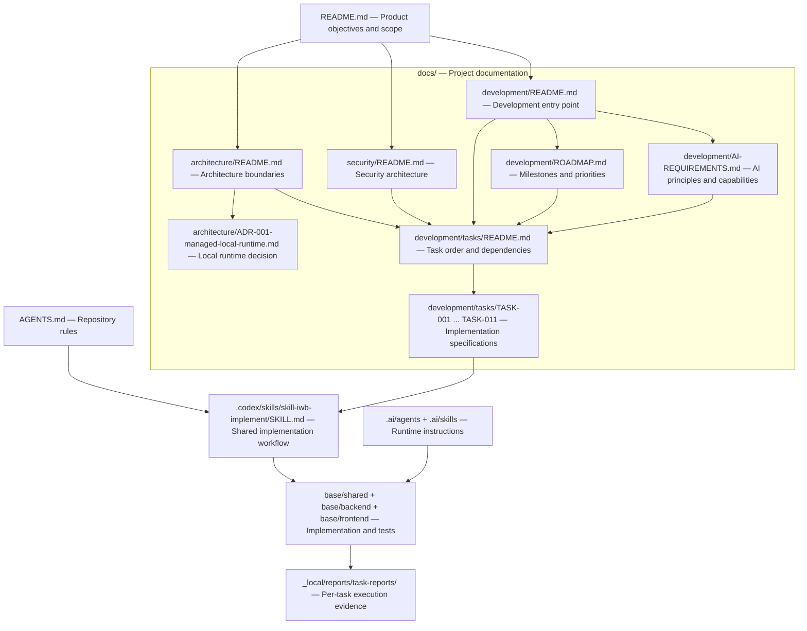
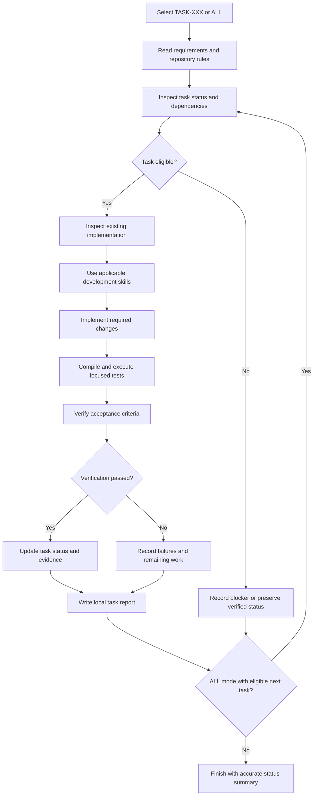

# Development

**Bootstrap status:** COMPLETE  
**Base Plugin MVP status:** IN PROGRESS — Milestone B

This directory defines the development process for Integrated AI Workbench, including implementation planning, AI
engineering requirements, task execution, and verification.

The root [README.md](../../README.md) establishes product objectives and scope. Development documentation translates
these objectives into verifiable implementation tasks.

Development prioritizes operational capabilities, existing IntelliJ Platform resources, programmatically enforced
security, and reproducible verification.

## Development environment

| Component                       | Configuration                                   |
|---------------------------------|-------------------------------------------------|
| Development IDE                 | IntelliJ IDEA Ultimate 2026.2.1                 |
| Target platform                 | IntelliJ Platform 2026.1.3                      |
| Java toolchain                  | JDK 21                                          |
| Kotlin                          | 2.3.20                                          |
| Gradle Wrapper                  | 9.1.0                                           |
| IntelliJ Platform Gradle Plugin | 2.19.0                                          |
| Build structure                 | Single Gradle module with separate source roots |
| Local inference                 | Workbench-managed llama.cpp runtime             |
| IDE tool integration            | IntelliJ IDEA MCP Server                        |
| MCP client transport            | STDIO                                           |

Use the repository's Gradle Wrapper. Do not require a system-wide Gradle installation.

The platform target and toolchain must remain compatible. Changes require explicit technical justification and
verification.

Machine-specific runtime executables, model locations, MCP ports, and project paths must remain configurable rather than
embedded in portable application source code.

### Development commands

Run from the repository root:

```powershell
.\gradlew.bat compileKotlin
.\gradlew.bat test
.\gradlew.bat check
.\gradlew.bat build
.\gradlew.bat verifyPluginStructure
.\gradlew.bat runIde
```

`runIde` launches a separate IntelliJ Development Instance.

Milestone A compilation, plugin structure verification, Development Instance startup, and basic Tool Window registration
have been validated.

Milestone B has subsequently established managed local inference and the agent execution foundation.

The remaining MVP work includes the operational Tool Window, authorized MCP tool execution, evaluation completion, and
integrated verification.

### IntelliJ MCP environment

The Base Plugin uses existing IntelliJ IDEA tools exposed through the IDE's MCP Server.

The Workbench acts as an MCP client using the selected STDIO transport.

The configured IntelliJ `stdioMcpServer` entry point provides access to the existing MCP Server.

Tool availability is controlled through IntelliJ IDEA MCP settings. Agent permissions and Workbench security policies
provide additional execution restrictions.

Before MCP integration verification, confirm:

- The intended IntelliJ IDEA instance is running.
- Its MCP Server is enabled.
- The required IDE tools are exposed and enabled.
- The configured STDIO command establishes a working client session.
- The project path and MCP Server port identify the intended project and IDE instance.
- The selected runtime agent is authorized to use the relevant tools.

The normal development IDE and the Gradle `runIde` Development Instance may have different processes, projects, MCP
ports, and exposure settings.

Do not assume that they share an MCP configuration.

Actual MCP integration and tool execution belong to TASK-009.

## Documentation and execution architecture

The following diagram shows the relationship between product requirements, architecture, development documentation,
implementation tasks, Codex execution, and verification reports.



The diagram represents documentation and execution dependencies, not separate deployable software modules.

The root README establishes product requirements. Architecture and security documents define component responsibilities
and enforceable boundaries.

The roadmap defines implementation milestones. AI requirements define functional capabilities. The task backlog defines
dependencies and execution order.

Individual TASK specifications contain implementation requirements and acceptance criteria.

The shared Codex implementation skill executes those specifications using the existing project structure and development
rules.

Runtime agents and skills under `.ai/` are distinct from Codex development automation under `.codex/skills/`.

Verification reports record actual implementation evidence without becoming part of the committed source tree.

## Development milestones

### Milestone A — Plugin bootstrap

**Status: COMPLETE**

Established foundations:

- Gradle and Kotlin project configuration.
- IntelliJ Platform plugin registration.
- Frontend, shared, and backend source boundaries.
- Initial model, runtime, agent, grounding, security, and evaluation contracts.
- Minimal IntelliJ-native Tool Window.
- Initial architecture and development documentation.
- Verified build and Development Instance startup.

**Outcome:** An operational IntelliJ plugin foundation.

Milestone A did not include operational local inference. That capability was implemented during Milestone B.

### Milestone B — Base Plugin MVP

**Status: IN PROGRESS**

Implement and verify the core Workbench capabilities:

- Validated model profiles and configuration.
- Local model registry and hardware compatibility.
- Workbench-managed local inference.
- Runtime-loaded Markdown agents and skills.
- Controlled grounding and prompt composition.
- Programmatically enforced security.
- Structured output and agent execution.
- Existing IntelliJ IDEA tools through the MCP Server.
- STDIO MCP client integration and authorized tool execution.
- Local-model continuation after tool results.
- IntelliJ-native user interaction.
- Deterministic evaluation and local LLM-as-a-Judge.
- Complete end-to-end MVP verification.

#### Current implementation progress

The following reflects the latest reported task evidence. Actual acceptance records remain authoritative.

| Tasks             | Implementation area                                             | Reported status              |
|-------------------|-----------------------------------------------------------------|------------------------------|
| TASK-001–TASK-003 | Execution contracts, model registry, hardware compatibility     | VERIFIED                     |
| TASK-004–TASK-005 | Managed local runtime and real local inference                  | VERIFIED                     |
| TASK-006–TASK-008 | Agents, skills, grounding, security, structured agent execution | VERIFIED                     |
| TASK-009          | Tool Window integration and operational MCP tool execution      | READY                        |
| TASK-010          | Deterministic evaluation and local judge integration            | IN PROGRESS                  |
| TASK-011          | Complete MVP integration and verification                       | BLOCKED pending dependencies |

TASK-004 and TASK-005 established real local-model execution through a Workbench-managed runtime.

TASK-008 established the agent execution coordinator and validated tool-authorization boundaries. It did not establish
actual IDE tool execution.

TASK-009 connects the existing coordinator to the IntelliJ Tool Window and IntelliJ MCP Server. It must verify a real
tool call through STDIO, return the result to the local model, and obtain a validated continuation response.

TASK-010 completes deterministic evaluation and local LLM-as-a-Judge integration.

TASK-011 verifies the integrated workflow using real inference, authorized IDE tools, security enforcement, and
applicable local judge execution.

The implementation sequence and acceptance criteria are defined in the [task backlog](tasks/README.md).

Future integrations and advanced capabilities are described in the [roadmap](ROADMAP.md).

### Milestone C — Optional extensions

**Status: FUTURE**

Potential extensions include additional inference backends, optional cloud providers, advanced retrieval, custom-built
tools, external MCP servers, multi-agent orchestration, and advanced model capabilities.

The ability to use existing IntelliJ IDEA tools through the configured MCP integration is part of Milestone B, not a
future optional extension.

## Task execution

All implementation tasks use one shared Codex development skill:

[skill-iwb-implement](../../.codex/skills/skill-iwb-implement/SKILL.md)

The shared skill supports two invocation modes.

### Single-task execution

Execute or resume one selected implementation task:

```text
$skill-iwb-implement TASK-009
```

The selected task's requirements, dependencies, acceptance criteria, and verification evidence determine whether
execution can proceed.

Single-task invocation does not automatically require implementation of unrelated tasks.

### Dependency-aware execution

Execute or resume eligible tasks using the shared implementation workflow:

```text
$skill-iwb-implement ALL
```

In `ALL` mode, the skill must:

- Inspect existing task statuses, specifications, and reports.
- Preserve previously verified work.
- Respect documented dependencies.
- Resume incomplete tasks where appropriate.
- Execute dependency-ready tasks in the required order.
- Verify each task against its acceptance criteria.
- Update the corresponding local report.
- Continue to subsequent eligible tasks when the workflow permits.
- Record blockers and avoid claiming completion without evidence.

The `ALL` mode must not skip mandatory verification or override task dependencies.

A blocked task must not be marked complete merely because another task is ready or has passed its tests.

### Shared implementation procedure

The implementation workflow follows this general sequence:



The task specification defines the required functionality and acceptance criteria. The shared skill defines the
execution procedure.

Every TASK specification links to the same skill with its own identifier.

The [planning skill](../../.codex/skills/skill-integrated-ai-workbench/SKILL.md) maintains these references and must not
generate individual implementation skills or task-specific wrappers.

Changes to the shared workflow must preserve existing TASK requirements, dependency rules, and completion records.

Specialized Codex skills may be used for testing, security, Gradle diagnostics, debugging, MCP integration, concurrency,
and code review when available and applicable.

The installed `mcp-builder` development skill may provide MCP implementation guidance. Its presence does not guarantee
that it supplies a ready-made MCP client implementation.

Do not introduce unnecessary dependencies or expand task scope without justification.

## Task reports

Each task execution produces or updates a compact Markdown report under:

`_local/reports/task-reports/`

Report naming convention:

`task-001.md` through `task-011.md`

Reports record:

- Actual implementation changes.
- Relevant files and components.
- Compilation results.
- Test execution and outcomes.
- Real integration verification where required.
- Supporting development skills used.
- Remaining issues or blockers.
- Final task acceptance status.

The latest execution updates the corresponding report rather than creating duplicate reports.

The `_local/` directory remains excluded from version control.

Use `_local/reports/task-reports/task-XXX.md` with the selected task's lowercase filename.

Before writing a report, confirm that the path is ignored and no local reports are tracked:

```powershell
git check-ignore _local/reports/task-reports/task-009.md
git ls-files -- _local/
```

Version-controlled TASK specifications retain their completion status and concise verification evidence.

Local execution reports must not be committed to GitHub.

Do not report tests, runtime checks, or MCP operations as successful unless they were actually executed.

## Implementation and verification rules

- Preserve the single Gradle module and existing architectural boundaries.
- Reuse established contracts, services, and IntelliJ Platform capabilities.
- Keep `.ai/` runtime instructions separate from `.codex/skills/` development automation.
- Maintain Workbench-managed local inference without mandatory cloud services or independently operated AI applications.
- Use existing IntelliJ IDEA MCP tools instead of duplicating equivalent IDE functionality.
- Use the selected STDIO MCP integration for the Base Plugin MVP.
- Respect IntelliJ MCP exposure settings and runtime agent permissions.
- Enforce security and tool authorization programmatically.
- Require operation-specific approval for consequential tool operations.
- Keep inference, MCP communication, and other long-running operations off the Event Dispatch Thread.
- Handle cancellation, timeouts, failures, and lifecycle cleanup.
- Run focused tests before broader Gradle checks.
- Verify real-model execution when required by the task.
- Verify actual MCP tool execution and model continuation under TASK-009 and TASK-011.
- Verify real local judge execution where required.
- Record only checks that have actually been executed.
- Do not treat compilation, generated files, fake-adapter tests, or mocked MCP traffic as sufficient evidence of
  complete functionality.
- Preserve unrelated local changes.
- Do not modify remote Git branches without authorization.

Task completion must satisfy every mandatory acceptance criterion in the corresponding specification.

Previously verified tasks must remain verified unless new evidence establishes a regression or invalidates their
acceptance criteria.

### Tool execution verification

Operational tool integration requires more than an MCP connection.

A valid end-to-end verification must establish:

1. A supported MCP client session through the configured STDIO transport.
2. Discovery of an actual enabled IntelliJ IDEA tool.
3. Authorization under the selected agent and Workbench security policy.
4. A validated structured tool-call proposal generated by a real local model.
5. Execution of the actual IDE tool.
6. Validation and safe handling of the tool result.
7. Delivery of the result to the local model.
8. Model continuation and a validated final response.

Consequential operations must additionally demonstrate correct approval, rejection, and cancellation behavior.

A tool enabled in IntelliJ settings is not automatically authorized for every Workbench agent.

The detailed acceptance criteria belong to [TASK-009](tasks/TASK-009-tool-window-workflow.md)
and [TASK-011](tasks/TASK-011-mvp-integration-verification.md).

## Documentation references

| Document                                                                        | Purpose                                                       |
|---------------------------------------------------------------------------------|---------------------------------------------------------------|
| [Root README](../../README.md)                                                  | Product scope and objectives                                  |
| [Architecture](../architecture/README.md)                                       | Component structure and responsibilities                      |
| [Managed local runtime ADR](../architecture/ADR-001-managed-local-runtime.md)   | Runtime selection and management architecture                 |
| [Security](../security/README.md)                                               | Trust boundaries and security enforcement                     |
| [Development roadmap](ROADMAP.md)                                               | Milestones and development priorities                         |
| [AI requirements](AI-REQUIREMENTS.md)                                           | AI engineering concepts, methods, and functional capabilities |
| [Task backlog](tasks/README.md)                                                 | Implementation order, dependencies, and task status           |
| [Shared implementation skill](../../.codex/skills/skill-iwb-implement/SKILL.md) | Codex implementation and verification procedure               |

Keep implementation details and task-specific acceptance criteria in their respective documents.

This README is the entry point for the development workflow, not a replacement for the architecture, security
requirements, or individual task specifications.

**Development principle:** Preserve working functionality, reuse existing capabilities, implement only the required
scope, and accept completion only when supported by verification evidence.