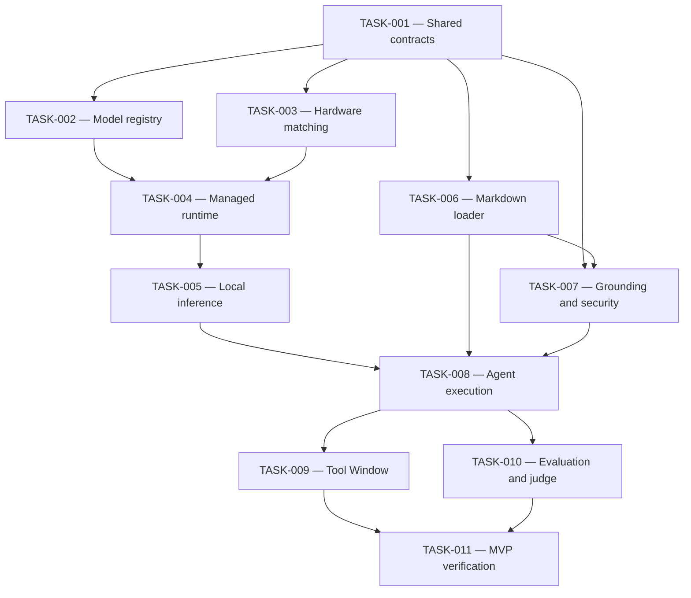

# Milestone B Implementation Backlog

**Status:** PLANNED — TASK-001 ready for implementation

This directory contains the dependency-ordered implementation backlog for the Integrated AI Workbench Base Plugin MVP.

Each task defines a specific development objective, affected components, implementation boundaries, acceptance criteria,
and verification requirements.

All tasks use one shared Codex implementation skill. Task specifications define **what must be implemented**; the shared
skill defines **how implementation, compilation, testing, review, and reporting are performed**.

A task is complete only when its required functionality has been implemented and verified against its documented
acceptance criteria.

## 1. Authoritative project documentation

The implementation workflow is governed by the existing repository documentation.

| Document                                                                                                  | Responsibility                                                                         |
|-----------------------------------------------------------------------------------------------------------|----------------------------------------------------------------------------------------|
| [Root README](../../../README.md)                                                                         | Product objectives, overall architecture, and scope                                    |
| [AGENTS.md](../../../AGENTS.md)                                                                           | Repository-wide development-agent instructions and restrictions                        |
| [Architecture README](../../architecture/README.md)                                                       | Component responsibilities and architectural boundaries                                |
| [ADR-001 — Managed Local Inference Runtime Boundary](../../architecture/ADR-001-managed-local-runtime.md) | Managed inference runtime decision, technical constraints, and implementation approach |
| [Security Architecture](../../security/README.md)                                                         | Security principles, trust boundaries, and enforcement requirements                    |
| [Development README](../README.md)                                                                        | Development environment, workflow, tools, and verification practices                   |
| [Development Roadmap](../ROADMAP.md)                                                                      | Milestones, implementation phases, and development priorities                          |
| [AI Requirements](../AI-REQUIREMENTS.md)                                                                  | AI engineering principles, functional capabilities, methods, and verification targets  |
| [Implementation Tasks](README.md)                                                                         | Task dependencies, execution readiness, progress, and completion rules                 |

The root README defines the product scope. Architecture and security documents establish technical constraints. The
development roadmap and AI requirements define implementation priorities and expected capabilities.

Individual TASK documents specify the concrete work and acceptance criteria.

The shared implementation skill executes the selected task within these constraints.

If documentation conflicts, identify the inconsistency before implementation. Do not silently replace established
requirements or architecture.

## 2. Implementation principles

All tasks must follow these rules:

- Preserve the existing single Gradle module and its `base/frontend`, `base/shared`, and `base/backend` source-root
  boundaries.
- Maintain provider-neutral model, runtime, agent, and execution contracts.
- Treat Workbench-managed local inference as a core product capability.
- Do not require LM Studio, Ollama, cloud providers, or independently operated AI applications.
- Keep user-supplied model files and runtime binaries outside source control.
- Preserve explicit model selection, validated local paths, and hardware-aware compatibility assessment.
- Keep runtime Markdown under `.ai/` separate from developer automation under `.codex/skills/`.
- Enforce security policies through application code rather than Markdown instructions alone.
- Reuse existing components and avoid unnecessary architectural changes.
- Use JDK 21 and the existing Gradle Wrapper.
- Introduce dependencies only after validating necessity, compatibility, security, and licensing.
- Implement functional behavior rather than disconnected placeholders.
- Create focused tests and verify relevant failure paths.
- Record only implementation and verification results actually obtained.
- Preserve unrelated local changes and the current Git branch.
- Do not commit, push, merge, reset, or otherwise modify remote Git branches without explicit authorization.

## 3. Task status definitions

| Status        | Meaning                                                                                                                       |
|---------------|-------------------------------------------------------------------------------------------------------------------------------|
| `READY`       | Required dependencies are verified; implementation may begin                                                                  |
| `BLOCKED`     | Required dependencies or resources prevent implementation                                                                     |
| `IN PROGRESS` | Implementation has started, but mandatory acceptance criteria or verification remain incomplete                               |
| `VERIFIED`    | Required functionality is implemented, all mandatory acceptance criteria are satisfied, and verification evidence is recorded |

A successful compilation does not establish that a task is `VERIFIED`.

Task status must reflect actual implementation and verification evidence.

## 4. Implementation tasks

| Order | Task                                                               | Status  | Dependencies                 | Expected outcome                                                                                |
|-------|--------------------------------------------------------------------|---------|------------------------------|-------------------------------------------------------------------------------------------------|
| 1     | [TASK-001](TASK-001-shared-execution-contracts.md)                 | VERIFIED | —                            | Validated model profiles and shared execution contracts, including thinking-level configuration |
| 2     | [TASK-002](TASK-002-model-registry-and-local-paths.md)             | VERIFIED | TASK-001                     | Secure registration and discovery of user-supplied local models                                 |
| 3     | [TASK-003](TASK-003-hardware-capabilities-and-runtime-matching.md) | VERIFIED | TASK-001                     | Hardware capability detection and deterministic runtime compatibility matching                  |
| 4     | [TASK-004](TASK-004-managed-runtime-lifecycle.md)                  | VERIFIED | TASK-002, TASK-003           | Verified b11429 CPU runtime selection, managed lifecycle, and fake adapter                     |
| 5     | [TASK-005](TASK-005-local-inference-vertical-slice.md)             | VERIFIED | TASK-004                        | Verified real local inference through a Workbench-managed runtime                               |
| 6     | [TASK-006](TASK-006-runtime-markdown-loader.md)                    | VERIFIED | TASK-001                     | Validated runtime loading of Markdown agents, skills, and instructions                          |
| 7     | [TASK-007](TASK-007-grounding-prompt-and-security-pipeline.md)     | VERIFIED | TASK-001, TASK-006           | Controlled grounding, prompt composition, and programmatically enforced security                |
| 8     | [TASK-008](TASK-008-agent-execution-and-structured-output.md)      | VERIFIED | TASK-005, TASK-006, TASK-007   | Integrated agent execution, structured-output validation, and authorization                     |
| 9     | [TASK-009](TASK-009-tool-window-workflow.md)                       | BLOCKED | TASK-008                     | Functional IntelliJ Tool Window for model and agent interaction                                 |
| 10    | [TASK-010](TASK-010-evaluation-and-judge.md)                       | VERIFIED | TASK-008                     | Deterministic evaluation and bounded local LLM-as-a-Judge                                       |
| 11    | [TASK-011](TASK-011-mvp-integration-verification.md)               | BLOCKED | TASK-009, TASK-010           | Verified end-to-end MVP with real local inference, evaluation, and recorded test evidence       |

The task specifications are authoritative for task-specific scope and acceptance criteria.

Do not change task dependencies or acceptance criteria implicitly during implementation.

## 5. Dependency structure



The implementation table defines the authoritative dependencies. The diagram is a visual representation.

After TASK-001 is verified, TASK-002, TASK-003, and TASK-006 may proceed independently.

TASK-004 is verified. TASK-005 may now begin its required real-inference verification using the verified managed runtime.

TASK-008 is verified: operational local inference, validated runtime Markdown, the grounding/security pipeline, and
the integrated agent coordinator are verified.

TASK-009 and TASK-010 may proceed independently after TASK-008.

A task may start only when all its declared dependencies have been verified.

## 6. Shared Codex implementation skill

All 11 implementation tasks use one common skill:

**[skill-iwb-implement](../../../.codex/skills/skill-iwb-implement/SKILL.md)**

Location:

`.codex/skills/skill-iwb-implement/SKILL.md`

Invoke the skill with an explicit task identifier.

Example:

```text
$skill-iwb-implement TASK-001
```

The skill must:

1. Read the applicable repository instructions and task specification.
2. Verify task dependencies and inspect the existing implementation.
3. Select applicable specialized development skills available in the environment.
4. Implement the required functionality.
5. Compile the affected Kotlin code.
6. Create and execute focused tests.
7. Run the required Gradle verification.
8. Review the result against all mandatory acceptance criteria.
9. Update the selected task's completion record and status where justified.
10. Write a compact local task report.

The shared skill defines the execution procedure. It must not duplicate or override task-specific requirements.

Execute exactly one selected task per invocation.

Do not automatically continue to the next task.

Each TASK's `Implementation Skill` section links to this same file and supplies its matching TASK identifier.
Maintain task-specific requirements in the TASK specifications. Do not generate individual implementation skills or
task-specific wrappers; the planning skill must preserve this shared workflow.

### Specialized development skills

The implementation skill may use installed specialized skills for:

- Test creation and coverage review.
- Kotlin and Gradle diagnostics.
- Security review and threat analysis.
- Performance, concurrency, and resource management.
- IntelliJ Platform debugging.
- Independent code review.

Use only skills actually available in the current environment.

Supporting skills must not override repository instructions, security policies, or task acceptance criteria.

Record the names of supporting skills actually used.

## 7. Implementation and verification workflow

The standard development sequence is:

```text
Select TASK
    ↓
Read requirements and existing code
    ↓
Verify dependencies
    ↓
Select applicable development skills
    ↓
Implement functionality
    ↓
Compile
    ↓
Create focused tests
    ↓
Execute tests
    ↓
Run Gradle checks
    ↓
Review acceptance criteria
    ↓
Record evidence and status
    ↓
Write local task report
    ↓
Stop
```

### Compilation

Use the existing Gradle Wrapper.

Default Windows compilation command:

```powershell
.\gradlew.bat compileKotlin
```

If compilation fails, investigate and correct issues within the selected task's scope.

Do not claim compilation succeeded unless the command completed successfully.

### Automated testing

Create focused tests covering the applicable acceptance criteria.

Use deterministic fixtures, temporary files, and fake adapters where appropriate.

Run focused tests before the broader project checks.

Required baseline:

```powershell
.\gradlew.bat check
```

Run additional checks specified by the selected task, including applicable plugin verification or Development Instance
inspection.

### Real inference verification

Fake adapters support deterministic testing but cannot establish that a real inference backend works.

TASK-005 requires successful inference using an actual compatible user-supplied local model.

TASK-011 requires integrated verification of the operational Workbench, including actual local inference through the
IntelliJ Tool Window and applicable local judge execution.

If required model resources or runtime capabilities are unavailable, record the limitation and retain an incomplete task
status.

Do not replace mandatory functional verification with simulated results.

## 8. Local task reports

Every task execution must create or update a compact Markdown report.

Report directory:

`_local/reports/task-reports/`

Report filenames:

- `task-001.md`
- `task-002.md`
- `task-003.md`
- `task-004.md`
- `task-005.md`
- `task-006.md`
- `task-007.md`
- `task-008.md`
- `task-009.md`
- `task-010.md`
- `task-011.md`

Each report must contain:

- Task identifier and current status.
- Actual implemented changes.
- Main modified files or components.
- Specialized development skills actually used.
- Compilation result.
- Test commands and outcomes.
- Gradle verification result.
- Applicable runtime or UI verification.
- Number of satisfied acceptance criteria.
- Remaining issues or blockers.
- Next actionable step.

Reports must remain concise, preferably within 20 lines.

Overwrite the existing report for the selected task with its latest consolidated state.

Do not include unnecessary logs, credentials, model contents, hidden reasoning, or sensitive local configuration.

The `_local/` directory must remain excluded from Git.

Verify the selected report path with `git check-ignore -- _local/reports/task-reports/task-XXX.md` and check
`git ls-files -- _local/` for already tracked files. Use the actual lowercase task filename in the command.

Local reports provide detailed execution feedback. The version-controlled task completion records provide durable,
concise verification evidence.

## 9. Completion and status updates

After implementation and verification:

1. Compare the result against every mandatory acceptance criterion in the selected TASK specification.
2. Record actual compilation, test, runtime, or UI results.
3. Identify unresolved failures and limitations.
4. Update the task's completion record.
5. Set the task to `VERIFIED` only when all mandatory criteria are satisfied.
6. Synchronize the status in this backlog.
7. Update relevant AI capability or architecture documentation only when implementation evidence justifies it.
8. Report newly eligible dependent tasks as a next step without changing their statuses in this task execution.

If implementation is incomplete, retain `IN PROGRESS`.

If prerequisites or required resources prevent execution, use `BLOCKED`.

Do not mark a task complete because files were generated, compilation passed, or a fake adapter returned a successful
response.

## 10. Implementation priorities

### First operational local inference — TASK-005

The initial priority is to establish reliable, Workbench-managed local inference.

Complete the required foundation through TASK-001, TASK-002, TASK-003, and TASK-004.

TASK-005 must verify actual text generation with a compatible local model.

### Integrated AI workflow — TASK-008

Connect local inference with runtime Markdown agents and skills, controlled project grounding, prompt composition,
security enforcement, and structured output.

### IntelliJ interaction and evaluation — TASK-009 and TASK-010

Make the operational workflow available through the IntelliJ Tool Window.

Integrate deterministic evaluation and optional bounded local LLM-as-a-Judge execution.

### MVP completion — TASK-011

Verify the complete Base Plugin against documented functionality, security, reliability, and integration requirements.

Milestone B is complete only when all mandatory tasks are `VERIFIED` and the integrated workflow operates successfully
using real local inference.

## 11. Current next step

**TASK-009 — Tool Window workflow**

**Status:** READY

Specification:

[TASK-009 — Tool Window workflow](TASK-009-tool-window-workflow.md)

Implementation skill:

[skill-iwb-implement](../../../.codex/skills/skill-iwb-implement/SKILL.md)

Invocation:

```text
$skill-iwb-implement TASK-009
```

TASK-009 and TASK-010 may be implemented independently.

The skill must stop after the selected task and produce:

- Verified implementation changes.
- Relevant compilation and test results.
- Updated task status and completion evidence.
- `_local/reports/task-reports/task-009.md`

Do not begin another task automatically.
