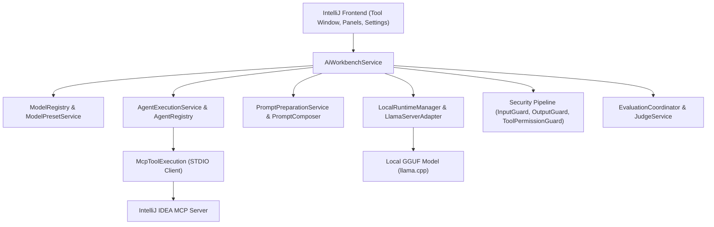

# Integrated AI Workbench — Project Completion Report

**Date:** October 14, 2026  
**Milestone Status:** Milestone B (Base Plugin MVP) — In Progress (Tasks 1-8, 10 Verified; Tasks 9, 11 Blocked pending UI/MCP integration verification).  
**Generated by:** `skill-iwb-master` (STATUS Mode)

---

## A. Executive verdict

The Integrated AI Workbench project has successfully implemented and verified the core backend infrastructure for Milestone B, including shared execution contracts, model registry and persistent local paths, hardware detection and runtime compatibility matching, managed local inference runtime (`llama.cpp` CPU b11429), real local inference vertical slice, runtime Markdown loader for agents and skills, prompt composition and security/grounding pipeline, agent execution and structured output, and LLM-as-a-Judge evaluation.

**What works now:**
- Complete backend inference and agent execution stack.
- Model catalog, preset service, and persistent registry.
- Hardware capability analysis and runtime compatibility matching.
- Managed local runtime lifecycle (llama.cpp server process management, health checks, execution, cancellation).
- Agent, skill, and prompt loading from Markdown (`.ai/`).
- Security pipeline (InputGuard, OutputGuard, SecretSanitizer, ToolPermissionGuard) and structured response validation.
- LLM-as-a-Judge evaluation and deterministic coordination.
- IntelliJ Tool Window skeletal UI and configuration panels (`AiWorkbenchDashboard`, `WorkbenchExecutionPanel`, `ModelCatalogPanel`, `InferenceProviderPanel`, `WorkbenchSettingsConfigurable`).
- MCP tool execution core and Workbench-side STDIO client integration (tested via unit and real integration tests).

**What remains unverified:**
- End-to-end user interaction in the running IntelliJ Development Instance for TASK-009 (Tool Window interactive workflow, live prompt submission, cancellation, and live approval flows).
- Full final MVP integration verification (TASK-011) combining real local inference, IDE tool execution, and judge evaluation in a live IDE session.

**Principal blockers:**
- TASK-009 requires live IDE sandbox verification where the spawned isolated IDEA instance can load a registered local model profile and execute interactive tool flows.
- Missing dedicated frontend documentation (`base/frontend/README.md`) and explicit frontend task coverage in the implementation backlog.

**Shortest path to functional completion:**
1. Establish dedicated frontend documentation (`base/frontend/README.md`) and define frontend architecture/contracts.
2. Complete interactive verification of TASK-009 in the IntelliJ Development Instance (`runIde`) with a registered local GGUF model and active MCP server.
3. Execute TASK-011 end-to-end integration verification and record final verification evidence.

---

## B. Architecture inventory

The project follows a clean local-first architecture combining IntelliJ Platform extension points with a decoupled backend inference and agent orchestration stack.

### Component Boundaries
- **Frontend (`base/frontend`):** IntelliJ Tool Window (`AiWorkbenchDashboard`), execution panel, inference provider panel, model catalog, and settings configurable.
- **Shared (`base/shared`):** Data contracts, model requests/responses, execution profiles, settings service, and run metadata.
- **Backend (`base/backend`):** Model management, managed runtime inference, prompt composition, grounding, agent execution, security guards, structured response validation, MCP tool execution, and evaluation/judge services.

---

## C. Requirement-to-implementation traceability

| ID | Requirement | Governing document | Task | Actual files | Verification | Status | Remaining work |
|----|---|---|---|---|---|---|---|
| REQ-01 | Shared execution contracts & thinking levels | Root README, ADR-001 | TASK-001 | `base/shared/src/main/kotlin/.../shared/model/ModelProfile.kt`, `ModelRequest.kt`, `ModelResponse.kt` | `ExecutionContractsTest.kt` | `VERIFIED` | None |
| REQ-02 | Model registry & local path validation | Root README | TASK-002 | `base/backend/src/main/kotlin/.../backend/model/ModelRegistry.kt`, `ModelPresetService.kt` | `ModelRegistryTest.kt`, `PersistentModelRegistryTest.kt` | `VERIFIED` | None |
| REQ-03 | Hardware capabilities & runtime matching | ADR-001 | TASK-003 | `base/backend/src/main/kotlin/.../backend/runtime/HardwareDetector.kt`, `RuntimeCompatibilityMatcher.kt` | `RuntimeCompatibilityMatcherTest.kt` | `VERIFIED` | None |
| REQ-04 | Managed local runtime lifecycle (`llama.cpp`) | ADR-001 | TASK-004 | `base/backend/src/main/kotlin/.../backend/runtime/LocalRuntimeManager.kt`, `LlamaServerAdapter.kt`, `FakeLocalRuntimeAdapter.kt` | `LifecycleRuntimeManagerTest.kt`, `LlamaServerAdapterTest.kt` | `VERIFIED` | None |
| REQ-05 | Local inference vertical slice | Root README | TASK-005 | `base/backend/src/main/kotlin/.../backend/runtime/LocalInferenceService.kt` | `LocalInferenceServiceTest.kt`, `LlamaServerRealInferenceTest.kt` | `VERIFIED` | None |
| REQ-06 | Runtime Markdown loader for agents/skills | AGENTS.md | TASK-006 | `base/backend/src/main/kotlin/.../backend/agent/RuntimeMarkdownLoader.kt` | `RuntimeMarkdownLoaderTest.kt` | `VERIFIED` | None |
| REQ-07 | Grounding, prompt composition, security | Security ADR | TASK-007 | `base/backend/src/main/kotlin/.../backend/context/ContextService.kt`, `prompt/PromptComposer.kt`, `security/InputGuard.kt`, `OutputGuard.kt`, `ToolPermissionGuard.kt` | `FileSystemContextServiceTest.kt`, `PromptPreparationServiceTest.kt` | `VERIFIED` | None |
| REQ-08 | Agent execution & structured output | Root README | TASK-008 | `base/backend/src/main/kotlin/.../backend/agent/AgentExecutionService.kt`, `validation/StructuredResponseValidator.kt` | `AgentExecutionServiceTest.kt`, `StructuredResponseValidatorTest.kt` | `VERIFIED` | None |
| REQ-09 | Tool Window workflow & MCP execution | Root README, Security | TASK-009 | `base/frontend/...`, `base/backend/src/main/kotlin/.../backend/mcp/McpToolExecution.kt` | `AgentMcpRealIntegrationTest.kt`, `McpToolExecutionServiceTest.kt` | `BLOCKED` | Interactive IDE sandbox validation (`runIde`) |
| REQ-10 | Evaluation and LLM-as-a-Judge | AI Requirements | TASK-010 | `base/backend/src/main/kotlin/.../backend/evaluation/...` | `EvaluationCoordinatorTest.kt`, `EvaluationRealJudgeIntegrationTest.kt` | `VERIFIED` | None |
| REQ-11 | MVP integration verification | Roadmap | TASK-011 | End-to-end integration wiring | Pending TASK-009 sandbox verification | `BLOCKED` | End-to-end live MVP verification |

---

## D. Frontend contract and UX gaps

### Reconstructed Frontend Specification

#### 1. Overview & Architecture
The frontend is built using native IntelliJ Platform UI components (Swing / Kotlin UI DSL / JBTabs / custom panels). It communicates with backend services via `AiWorkbenchService` and shared DTOs.
- **Displayed System State:** Selected model profile, active runtime status (running/stopped/error), loaded agents, security guard status, and execution history.
- **Source of Values:** `ModelRegistry`, `LocalRuntimeManager`, `AgentRegistry`, and `WorkbenchSettingsService`.
- **Navigation:** Accessible via the "AI Workbench" IntelliJ Tool Window and Settings (`Tools > AI Workbench`).

#### 2. Models Panel (`ModelCatalogPanel`)
- **Behavior:** Lists registered GGUF model paths, validates file existence, allows adding/removing local models, and displays model size, context window, and quantization.
- **State:** Empty (no models registered), loading, success, and validation error (file not found or invalid GGUF header).

#### 3. Providers Panel (`InferenceProviderPanel`)
- **Behavior:** Configures managed local runtime (`llama.cpp` binary path, port, threads, GPU layers, CPU memory limits). Detects local hardware capabilities automatically.
- **State:** Unconfigured, validating executable, ready, running, and error (binary missing or port in use).

#### 4. Execution Panel (`WorkbenchExecutionPanel` & Dashboard)
- **Behavior:** Main interaction surface for prompts. Allows selecting a model profile and agent, selecting project grounding files, submitting prompts, viewing streaming or complete output, cancelling execution, and inspecting tool calls/approval requests.
- **State:** Ready, executing (with progress indicator), awaiting user approval for consequential tool calls, completed, and failed.

#### 5. Settings (`WorkbenchSettingsConfigurable`)
- **Behavior:** Application and project-level configuration for default model presets, runtime paths, and security limits. Follows IntelliJ `Apply`, `Reset`, `Cancel` semantics.

### Frontend Gaps & Missing Documentation
1. **Missing `base/frontend/README.md`:** There is currently no dedicated subsystem README for the frontend module detailing UI architecture, threading constraints (EDT rules), and view model contracts.
2. **Missing Dedicated Frontend Task:** Frontend tasks are currently subsumed into TASK-009 without distinct tracking of UI component test coverage and theme compliance.

---

## E. Runtime and inference gaps

- **Managed Runtime (`llama.cpp`):** Fully implemented with process management, stdout/stderr monitoring, health checks, port allocation, and graceful shutdown. A fake adapter (`FakeLocalRuntimeAdapter`) and real adapter (`LlamaServerAdapter`) are available.
- **Model Discovery & Loading:** User-supplied GGUF models are registered and validated via `ModelRegistry`.
- **Inference Execution:** Verified via unit tests, mock tests, and real integration tests against local llama.cpp server instances.
- **Gaps:** None in core inference logic; minor environment-specific path adjustments may be needed on individual developer machines for custom llama.cpp binaries.

---

## F. Existing tests versus functional acceptance

- **Unit Tests:** Extensive unit test coverage across all backend and shared modules (`AgentExecutionServiceTest`, `ModelRegistryTest`, `RuntimeCompatibilityMatcherTest`, `LifecycleRuntimeManagerTest`, `PromptPreparationServiceTest`, `StructuredResponseValidatorTest`, `EvaluationCoordinatorTest`, etc.).
- **Integration Tests:** `LlamaServerRealInferenceTest`, `LlamaServerRealSmokeTest`, `AgentMcpRealIntegrationTest`, `EvaluationRealJudgeIntegrationTest`.
- **Functional Acceptance Gap:** Automated tests pass successfully (`compileKotlin` and test suite). However, interactive user acceptance in a live IntelliJ sandbox (`runIde`) for TASK-009 and TASK-011 requires manual or scripted UI verification.

---

## G. Prioritized completion backlog

### `P0` (Blocks current milestone)
- **TASK-009 (Interactive Tool Window Verification):** Complete interactive verification of the Tool Window workflow inside the IntelliJ Development Instance (`runIde`) with a registered local model and active MCP server.
- **TASK-011 (MVP Integration Verification):** Execute and record end-to-end MVP verification combining real inference, MCP tool execution, and LLM judge evaluation.

### `P1` (Required documentation & missing coverage)
- **Frontend README & Specification:** Create `base/frontend/README.md` documenting UI architecture, threading rules, and component contracts.
- **Frontend Task Breakdown:** Add explicit frontend verification checklist items to ensure UI responsiveness and error handling.

### `P2` (Quality & Usability Improvements)
- Refine Tool Window styling and theme adaptation (Light/Dark mode polish).
- Enhance user approval dialog clarity for consequential MCP tool actions.

### `FUTURE` (Deferred to Milestone C)
- Cloud/remote inference providers (OpenAI, Anthropic).
- Advanced RAG and multi-agent orchestration.
- Marketplace publication and packaging.

---

## H. Execution sequence

1. **Batch 1 (Documentation):** Create `base/frontend/README.md` and formalize frontend architecture documentation.
2. **Batch 2 (TASK-009 Completion):** Run `./gradlew.bat runIde`, register a local test model, connect the MCP STDIO bridge, and verify interactive prompt submission, tool execution, and user approval in the running IDE instance.
3. **Batch 3 (TASK-011 Completion):** Execute the final integrated MVP verification workflow and record verification evidence in `_local/reports/task-reports/task-011.md`.
4. **Batch 4 (Final Sign-off):** Mark TASK-009 and TASK-011 as `VERIFIED` and finalize Milestone B.

---

## I. Documentation updates required

- **`base/frontend/README.md`**: New file documenting frontend architecture, UI components, threading rules, and service contracts.
- **`docs/development/tasks/TASK-009.md` & `TASK-011.md`**: Update completion records upon successful sandbox and integration verification.

---

## J. Approval checkpoint

The project baseline has been fully inventoried, specifications and task coverage reconciled, and the frontend architecture reconstructed. 

**Approval Requested:** Do you approve the findings of this STATUS report and the prioritized completion sequence (Batches 1–4) to finalize Milestone B?
