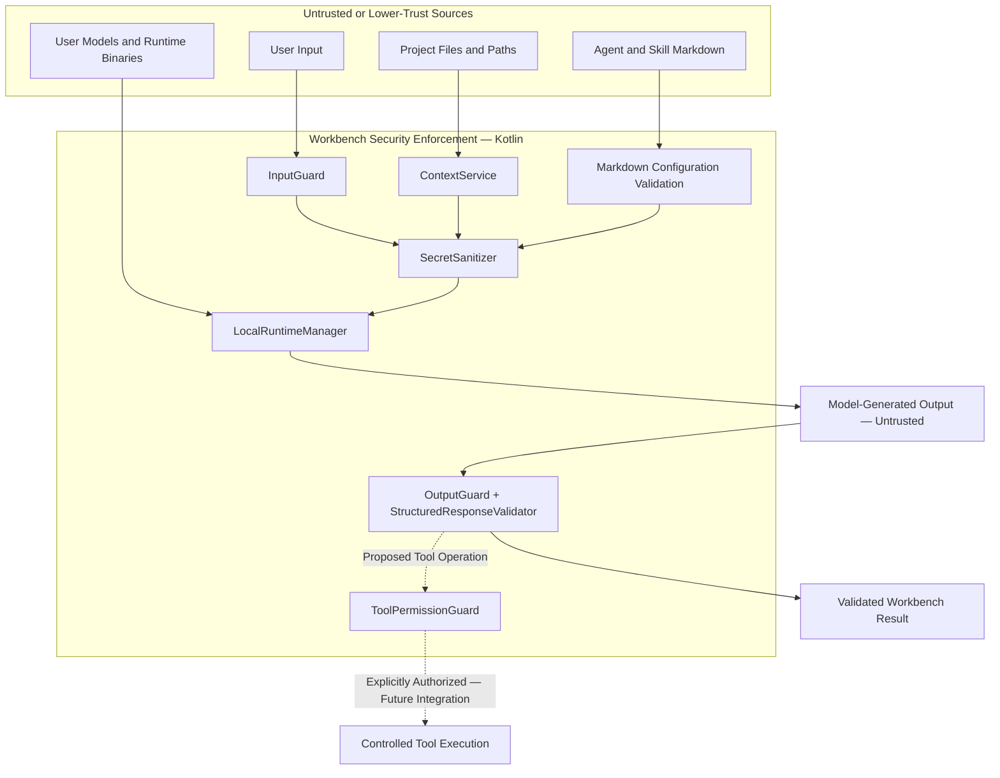
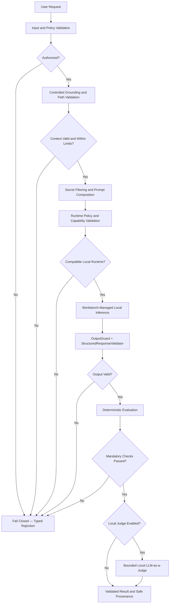

# Security Architecture

**Status:** PARTIAL

Security is a core responsibility of the Integrated AI Workbench Base Plugin, not an optional extension.

The architecture follows least-privilege, explicit authorization, controlled project access, and local-first execution
principles.

Security-sensitive operations must be enforced programmatically. Markdown instructions, agent definitions, and
model-generated responses are not trusted security boundaries.

## Security Boundaries

The Base Plugin separates security responsibilities across the following components:

- `InputGuard` — validates user input and enforces configured input limits.
- `SecretSanitizer` — detects and masks sensitive information before inappropriate exposure.
- `OutputGuard` — applies output limits and appropriate validation or sanitization.
- `ToolPermissionGuard` — enforces explicitly permitted tool operations.
- `StructuredResponseValidator` — validates machine-readable model responses.
- `ContextService` — provides controlled project grounding within configured access limits.
- `LocalRuntimeManager` — manages local inference runtime lifecycle and execution boundaries.

Model-generated instructions must never override application security policies or user permissions.

### Trust Boundary Architecture

The following diagram shows how lower-trust inputs are processed through Workbench-controlled application boundaries.

The diagram represents architectural responsibilities and intended security enforcement, not functionality already
completed in the bootstrap.

The model, its generated output, project files, and runtime Markdown must not be treated as sources of application
authority.

Permission decisions remain under Workbench control. Tool execution is not an unrestricted capability of the Base Plugin
MVP.

## Project Grounding and File Access

Project context must be collected selectively rather than exposing entire project directories automatically.

Required controls include:

- Allowed project roots and canonical path validation.
- Protection against path traversal and unauthorized symbolic-link access.
- Maximum file count, individual file size, and context size.
- Allowed file types and binary-file exclusion.
- Secret detection and filtering.
- Explicit control over context shared with local or future remote models.
- Visibility of the effective grounding sources.

Untrusted project content must be treated as data, not as instructions granting additional permissions.

Filesystem permissions and approved context boundaries must be revalidated where necessary before accessing files.

## Model and Runtime Security

Local inference is a native Workbench capability.

The Workbench must manage supported local runtimes without requiring an independently operated AI application or cloud
service.

Runtime security requirements include:

- Validation of model and runtime locations.
- Compatibility and capability checks.
- Verified runtime binaries and appropriate license handling.
- Controlled runtime initialization and termination.
- Execution timeouts and cancellation.
- Failure recovery and resource cleanup.
- Protection against unauthorized external network exposure.
- No unnecessary disclosure of sensitive data through process arguments, temporary files, or logs.

User-supplied models and external runtime components must not automatically be considered trustworthy.

A local-only execution policy must fail closed if no compatible local runtime is available.

The selected runtime architecture and its implementation constraints are documented
in [ADR-001 — Managed Local Runtime](../architecture/ADR-001-managed-local-runtime.md).

## Tool Execution and Permissions

Agent tool access must be explicitly controlled.

Required safeguards include:

- Tool allowlists and validated input parameters.
- Per-operation permission requirements.
- Explicit authorization for high-impact actions.
- Execution timeouts and controlled failure handling.
- Validation of structured tool requests before execution.
- No unrestricted operating-system access by default.

Model output must never be interpreted as permission to execute commands.

The `ToolPermissionGuard` must enforce permissions independently of agent instructions or model responses.

Actual tool execution requires a separately implemented and authorized integration. The Base Plugin MVP does not provide
unrestricted shell commands, file modification, or network operations through model-generated requests.

## Credentials and Sensitive Information

Credentials, API keys, tokens, passwords, and private keys must not be hard-coded, committed, or included in generated
documentation.

Persistent secrets should use IntelliJ PasswordSafe or another explicitly approved secure mechanism.

Project configuration, runtime state, model references, and credentials must remain separate.

Sensitive values must be excluded from:

- Model context unless explicitly authorized.
- Application logs and diagnostic output.
- Generated reports and execution history.
- Version-controlled files.
- Unnecessary external network requests.

Local execution reduces external data exposure but does not eliminate security risks.

## Validation and Evaluation

The following pipeline represents the intended sequence of programmatically enforced security checks.

### Security Enforcement Pipeline

Rejected requests and failed mandatory validations must return typed, safe outcomes without bypassing security controls.

Execution timeouts, cancellation, and runtime failures must also produce controlled outcomes.

If a judge is unavailable or returns an invalid assessment, its result must be reported separately without fabricating a
score or changing the deterministic validation result.

Deterministic security and validation failures cannot be overridden by an LLM-as-a-Judge evaluation.

LLM-based evaluation may assess semantic quality but does not replace programmatic security enforcement.

The pipeline does not authorize tool execution. Any future tool invocation must pass a separate `ToolPermissionGuard`
check before the operation is performed.

## Current Implementation

**Milestone A — COMPLETED**

The project contains bootstrap implementations or contracts for:

- `InputGuard`
- `SecretSanitizer`
- `OutputGuard`
- `ToolPermissionGuard`
- `StructuredResponseValidator`
- `ContextService`
- `LocalRuntimeManager`

These components establish architectural boundaries but are not yet integrated into a complete model-execution workflow.

Their existence does not imply that all security policies are operational or independently verified.

**Milestone B — PLANNED**

The next milestone will implement and integrate:

- Controlled grounding and file-access policies.
- Runtime security and execution controls.
- Input, context, and output validation.
- Secret protection and secure configuration persistence.
- Agent tool authorization boundaries.
- Security-focused deterministic tests.
- Execution provenance and diagnostic safeguards.

Security controls must be tested against valid, invalid, unauthorized, and malicious inputs where applicable.

Implementation and verification responsibilities are defined in the [Development Tasks](../development/tasks/README.md),
particularly TASK-004, TASK-007, TASK-008, and TASK-011.

The implementation must remain consistent with the
root [README.md](../../README.md), [Base Plugin Architecture](../architecture/README.md), and [